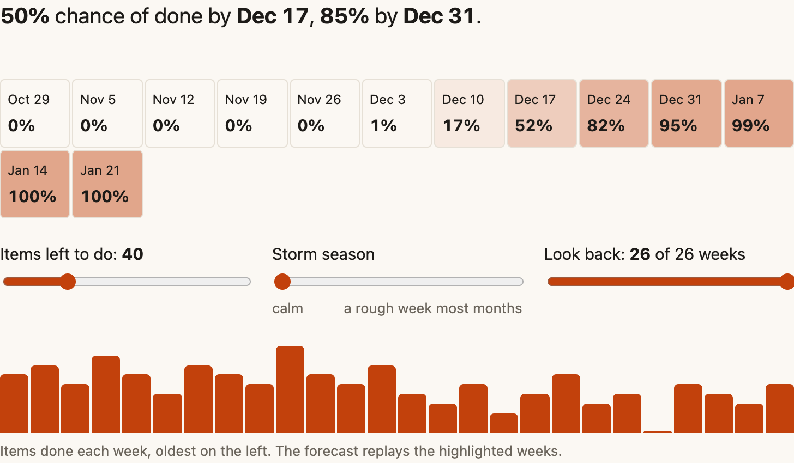
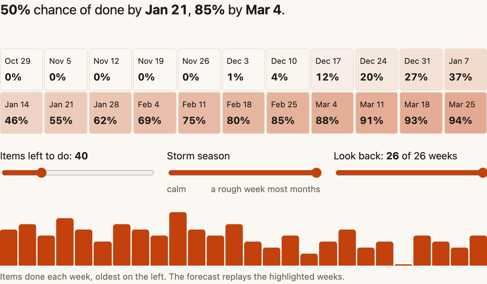

import Spectrum from '../../components/Spectrum.astro';

When will it be done?

It’s usually product asking, and sometimes you can hear the pressure behind the question: someone above them wants an exact date. That’s human. We all want the comfort of a due date, even in complex work where an honest one may not exist.

I’ve seen what happens when a team gives one anyway. One team estimated four weeks for a new feature. The code underneath was old, and building on it kept uncovering problems. The feature shipped four months later, and three months after that, customers were still reporting bugs and the team was still doing rework.

Psychologists have a name for part of this. Kahneman and Tversky called it the [planning fallacy](https://en.wikipedia.org/wiki/Planning_fallacy) in 1979: people underestimate how long their own work will take, even after watching past work run late.

## A weather forecast for your backlog

So I built [Chance of done](https://ahmedavais.com/p/chance-of-done), a weather forecast for your backlog. You tell it how many items are left. It replays your team’s past weeks of finished items in random order, 5,000 times, and counts how many of those futures are done by each coming week. There are no estimates and no story points. Replaying past throughput like this is a common practice in lean and agile teams.

You get a strip of weeks, each with its chance of done, and two dates. The 50% date is a coin toss. Plan on the 85% date.

When a stakeholder wants one date, I bring up the weather. In an environment as complex as a weather system, we need forecasts and confidence ratings to navigate. An 85% chance of rain is a strong likelihood, but it isn’t a guarantee.

My teams also make a wisdom-of-the-crowd estimate: everyone guesses in weeks of ideal engineering effort, and we take the median. It’s getting more accurate with time and consistency. What I like most is how efficient it is: no heavy debate, no planning poker over story points. Poker has its uses for surfacing valuable information, but its value diminishes. Sizing individual stories is a whole other ball of wax.

What makes a throughput forecast work is small stories. We aim for one to two days and split them when they get too large. Over months, I’ve seen the pattern again and again: a team’s ability to slice stories and its forecast accuracy improve together. You can take that to the bank.

## Storms and mudslides

Your history only holds the weeks you’ve had. So the tool has a storm season control, which drops in rough stretches of one to four weeks with nothing done. Turn it up and both dates move. The 85% date moves further.

On my teams, storms are high-severity CVEs, which seem to be happening more often. A record [48,185 CVEs were published in 2025](https://jerrygamblin.com/2026/01/01/2025-cve-data-review/), up 21% from 2024. Then there are supply chain attacks, like the [compromised tj-actions GitHub Action](https://www.cisa.gov/news-events/alerts/2025/03/18/supply-chain-compromise-third-party-github-action-cve-2025-30066) in March 2025, and GitHub Actions crumbling under pressure, which GitHub’s own [availability reports](https://github.blog/news-insights/company-news/github-availability-report-july-2026/) document. External customer factors, dependencies, you name it. Some days are better than others.

AI agents are changing the weather too. We ran a test with a few engineers, capturing what they thought each story would take and how long it actually took with our AI harness. There were still more variables than we wanted, but the general consensus was a sense of acceleration. Two-day stories got done in half a day, and one-day stories in a quarter of a day. And then there were places we got stuck. Trending fast overall, but mudslides still happen.

That’s where the look back control earns its place. If your team’s pace just changed, replaying every past week forecasts a team that no longer exists. Shorten the look back until the new pace settles.

## Weeds after the rain

The control that surprised me most was items left to do. Slide it past 100 and watch the dates run away. With a backlog that big, nothing will ever get done within reason.

Weeds grow fast after a rainy stretch, and backlogs do too. A backlog that big is a sign to weed. On my teams, stories drop off the count when YAGNI tells us we won’t need them, and new ones get added. “Some day, one day” items left sitting in a backlog become work nobody cares for. And for work already started, [work item age](https://prokanban.org/blog/the-kanban-pocket-guide-chapter-6-the-basic-metrics-of-flow) is the metric to watch. It tracks how long an item has been in progress, so you see stale work before it piles up.

## If you lead the team

If a leader still asks for story points, I’d engage a bit deeper to find the real concern hiding behind predictability. Are throughput and dates more important to them than points? If they’re senior, do they know story points don’t translate well from one team to another, and that seniority skews the numbers? And remember [Goodhart’s law](https://en.wikipedia.org/wiki/Goodhart%27s_law): when a measure becomes a target, it ceases to be a good measure.

Forecasting has limits too. That’s a story for another time, but borrowing from Dave Snowden’s [Cynefin framework](https://en.wikipedia.org/wiki/Cynefin), it starts with one question: which domain are you in?

<Spectrum
  title="Trust a forecast most in complicated work and least in chaos"
  source="Three of the domains in Dave Snowden’s Cynefin framework, with their responses"
  from="more trust in the forecast"
  to="less trust in the forecast"
  options={[
    { name: 'Complicated', points: ['Sense, analyze, respond', 'Forecasts and estimates work well'], highlight: true },
    { name: 'Complex', points: ['Probe, sense, respond', 'Some value, no promises', 'Be ready to adapt'] },
    { name: 'Chaotic', points: ['Act, sense, respond', 'Forecasting is a bad idea', 'Act to stabilize first'] },
  ]}
/>

Try the [forecast](https://ahmedavais.com/p/chance-of-done) with your own team’s weekly counts. They stay in your browser. Refresh it every week, trust the near weeks more than the far ones, and say the chance out loud.

I’d like to hear what your forecast says, and what storms look like on your teams.

This piece first went out in my newsletter, Dynamical Change. [Subscribe](https://ahmedavais.substack.com) to get the next one in your inbox.
