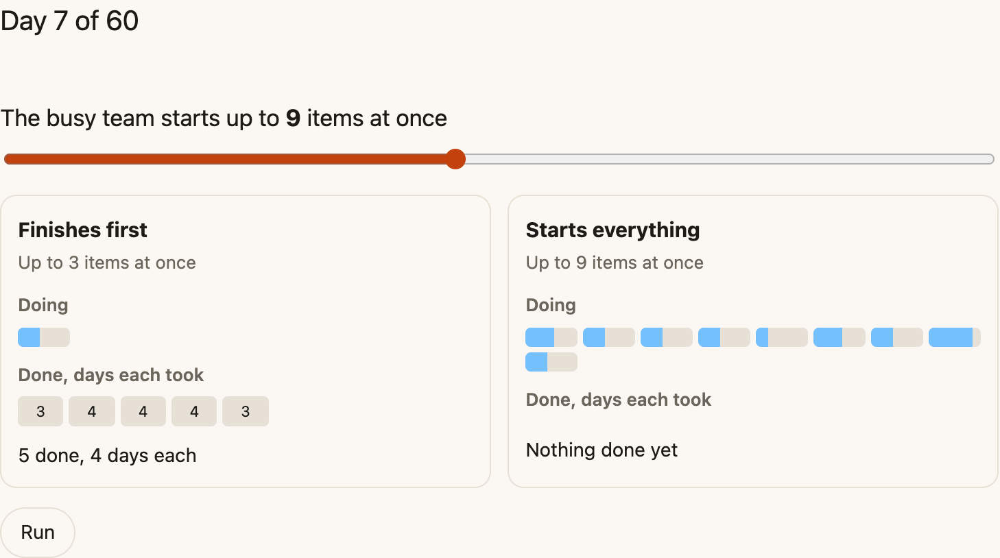

This probably sounds familiar. You have three or four things going on, and product has a long list of ideas waiting on engineering. Meanwhile, compliance vulnerabilities need fixing right away, someone has to cover on-call for customer calls, and hey, the week-long DR exercise is coming up too. Somewhere in there, you want to give folks time to be creative. And still someone asks: why can't you all do more?

Nobody wanted it this way. There's always more to do than there's capacity for, and the work depends on other work. Engineers want to make product happy. Production issues land in the middle of everything else, and we keep opening emergency lanes for them. Before long, we're working on everything and finishing very little. Too many spinning plates.

"Stop starting, start finishing" is an old line from the Kanban community. It sounds obvious when you say it out loud, and it's surprisingly hard to feel when you're the one spinning the plates. So I built something you can watch.

## The race

[Stop starting, start finishing](https://ahmedavais.com/p/stop-starting) puts two teams of three side by side on the same backlog, item for item. One team finishes what it has before it picks up anything new. The other keeps starting, up to a limit you set with a slider.

Let it run for a bit before you touch anything. Then move the slider and race again. Try a few limits and see where the busy team starts to fall behind.

I won't tell you the score. It changes a little every race, and you'll get more out of watching it than reading about it. Two things to keep an eye on while it runs:

- The busy team works as hard as the other one. Each person spreads their day across more items, and every switch between them costs a bit of the day.
- The "days each took" boxes matter more than the count of items done. That's the wait your customers feel.

## Why the waiting matters most

The second point is the one I'd sit with. With too much going at once, each item spends more of its life waiting, half-done, while people attend to everything else.

There's even a law for this. Little's law ties together how much work is in progress, how fast work gets finished, and how long each item takes. Start more without finishing faster, and everything takes longer. The race shows it in the "days each took" boxes.

For your customers, a feature that's 80% done is worth the same as one nobody started. And while it sits there, you're not learning anything from it either.

The model is simple on purpose. No meetings, no blockers, no bugs coming back, no one out sick. Real teams have all of those, and my guess is each one makes the gap bigger.

## What AI agents change

The model also leaves out something that's changing how my team works right now. It's still evolving, so the race doesn't capture it yet, but the same principle applies.

I've been a big proponent of mob programming, partly because it keeps fewer things in flight. When our mobs grew beyond four people, though, things got confusing and slow. So my team settled on three or four people per mob, which also set our work in progress: one item per mob.

AI agents are another fundamental shift. They make it easy to start more work. Four people watching an agent implement a spec isn't much of a spectator sport, and one engineer with an AI agent isn't really a pair either. Experienced humans are still critical, especially when the AI's output drifts ever so slightly. We're adding automated checks and automating more of the routine work where we can, but we can't put AI on autopilot. Not yet.

Our new sweet spot is two or three people, sometimes just two, working with AI agents. So far, it's working well. Even here, discipline matters, because AI amplifies what's already there, good engineering practices and bad ones alike. Work in progress still matters too. Avoid spinning plates, even now that they come with booster rockets. Stop starting, start finishing is more possible now than ever before. The discipline still needs nurturing.

## If you lead the team

Look back at the list at the top. Most of that pressure comes from outside the team, and leaders are part of it. If your first question in a status meeting is "what is everyone working on?", people learn that being busy is what you want to see. Try asking "what's closest to done, and what's in its way?" instead.

It also helps to be the person who says "not yet" to new work, so the team doesn't have to. A team can only keep a limit if the people asking for things respect it.

If you'd like to try this with your own team, the race makes a nice opener for a retro. Put it up, let it run, and see what people notice. Then count what your team has in progress right now, reviews and that side project included, and compare it with the number of people. If the first number is bigger, try finishing before starting for a couple of weeks. When someone gets blocked, they help finish something already in flight instead of picking up something new.

I'd like to hear what you see, in the race or on your own team.

This piece first went out in my newsletter, Dynamical Change. [Subscribe](https://ahmedavais.substack.com) to get the next one in your inbox.
