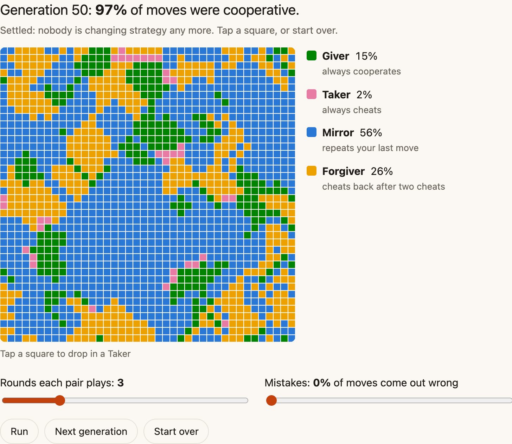
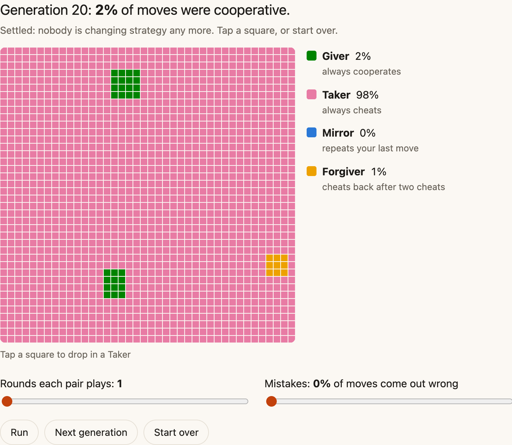
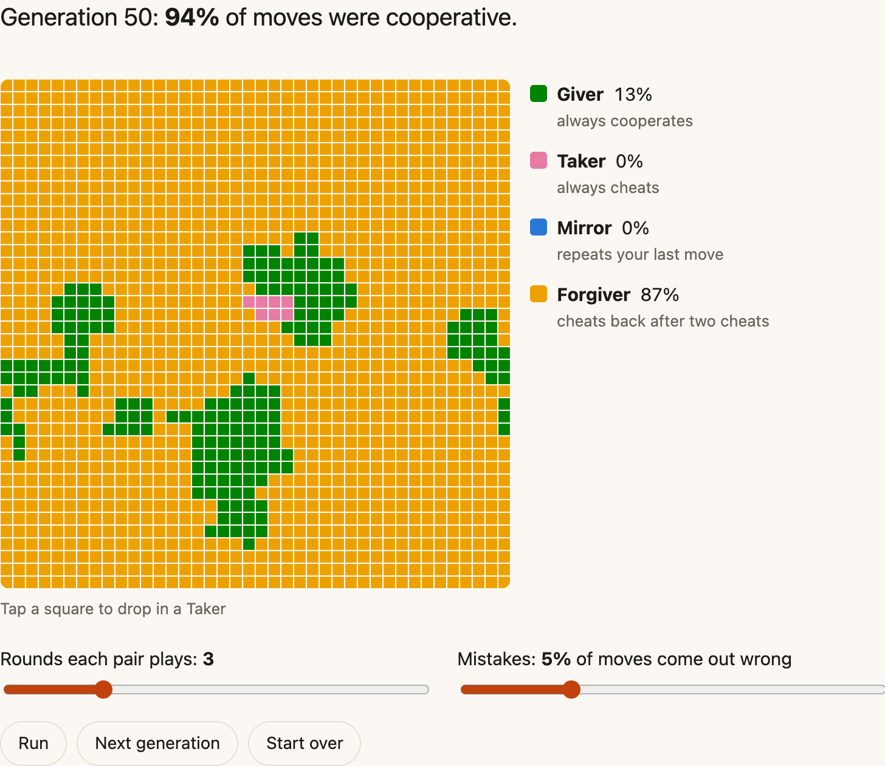

“Oh, we don’t do that here.”

That’s what I heard when I asked a team why their Jenkins pipelines had no ATDD and no business-level tests. It was a fintech, and I had recently joined as their agile coach.

The funny thing is, the team was nearly as new as I was. Some people had been at the company for years, but most had joined this team a couple of months earlier. Only the team lead and the product owner had been with the group for a few years. The people who started the habit had moved on to other teams. The habit stayed.

So why didn’t they do that there? Maybe it came up in onboarding, or while setting up a developer machine. Or maybe nobody ever said it and no one questioned it. They just mimicked what the relative senior was doing.

## Copy what works nearby

[Trust has neighbors](https://ahmedavais.com/p/trust-has-neighbors) shows how habits like that spread. It’s a grid of players. Each square meets its eight neighbors for a few rounds, and in every round both choose to cooperate or cheat. Cooperating together earns each player 2. Cheating someone who cooperates earns the cheat 3 and costs the other 1. Cheating each other earns nothing.

After every round of meetings, each player looks around and copies whichever strategy scored best nearby, its own included. That’s the only rule. Four strategies compete:

- Givers always cooperate.
- Takers always cheat.
- Mirrors cooperate first, then repeat their partner’s last move.
- Forgivers cheat back only after being cheated twice in a row.

Let it run, and within a few seconds trust wins. Mirrors and Forgivers spread, and Takers end up in small pockets.

*Three rounds per meeting, no mistakes: trust wins and the grid settles.*

The page builds on Nicky Case’s [The Evolution of Trust](https://ncase.me/trust/), where everyone meets everyone. On my grid you only meet your neighbors, the way you do at work.

## The team remembers

Trust lives with people. And yet a team is its own container, an entity with its own quirks and characteristics. It remembers moves that nobody on it today made.

On that fintech team, I looked for patterns. Who did everyone look at when they spoke? Who were the quiet but wise ones? Some turned out to be champion skeptics. One had a bad experience with the previous coach, who insisted on ceremony rather than talking about the why.

A Mirror on the grid repeats the last move it saw. This skeptic’s last move came from someone else. So I invested in the trust bank by showing up and doing what I said I was going to do. It took a few walks and talks, coffee, breaking bread, and answering questions without insulting anyone’s intelligence. I don’t remember exactly, but it took a few months before I saw the ice cracking and noticed they were +1 on what I was asking.

Then there was lunch. When the team ate with me and other leaders, they were quiet. Until one day someone mentioned cricket, and they all became chatterbugs. The normally quiet ones were so buoyant. After that they talked more in regular conversations and in retrospectives too.

With enough champions, we put engineering capacity into a more robust pipeline. The limitations from many years ago didn’t exist anymore. No one had felt the need to question them.

Robert Axelrod called the condition for cooperation the [shadow of the future](https://ee.stanford.edu/~hellman/Breakthrough/book/chapters/axelrod.html): the next meeting has to matter enough to make cheating unattractive. On the page, that’s the rounds slider. Set it to 1 and start over, and Takers sweep a fresh grid. Set it back to 3, let trust win, then drop it to 1. The grid stays as it is. Trust that already has neighbors protects itself.

*One round per meeting: Takers sweep a fresh grid.*

## Givers feed Takers

Kind teams have their own way to fail. Picture a team that says yes to every urgent request. A stakeholder learns that the fastest way to get something done is to skip the queue, so they skip it again. Other stakeholders notice and start doing the same. Nobody on the team pushes back, so the habit spreads, and the planned work waits.

Tap a square to drop a Taker into the grid. Among Mirrors, it gets absorbed in one generation. Among Givers, it spreads, because Givers never cheat back.

A Mirror’s answer can be calm: a visible queue, and “this goes behind what’s already in progress.” Cooperate with those who cooperate, and make skipping the line cost something.

## Cold wars

Mistakes wear trust down too. Turn mistakes up to 5%, and two Mirrors can feud forever over a single misread move, each repeating the other’s cheat. Forgivers let one cheat go and take over. [Nowak and Sigmund](https://www.nature.com/articles/355250a0) found something like it in 1992: once mistakes enter the game, a more generous strategy beats strict tit for tat.

*Mistakes at 5%: Mirrors feud themselves out, and Forgivers take over.*

At work I’ve seen cold wars more often than open feuds. Nothing gets said in a team setting, and nothing gets done about it. They show up in who gets invited to what, and in code reviews thrown over the fence with time zones as the excuse, when there are overlaps and chances to collaborate live. Each move is easy to deny, so the other side repeats it, and nobody calls a truce.

## No fixed strategy

Every player on the grid is stuck with one strategy until it copies another. People don’t have to be. Leadership agility asks those who are assertive all the time to be accommodating when the time calls for it, and those who are accommodating all the time to be assertive when the time calls for it. Knowing what fits the moment comes with skill and practice.

Try [Trust has neighbors](https://ahmedavais.com/p/trust-has-neighbors). Drop a Taker among Givers, turn up the mistakes, and see what holds.

What’s your team’s “we don’t do that here,” and does anyone still know why?

This piece first went out in my newsletter, Dynamical Change. [Subscribe](https://dynamicalchange.com) to get the next one in your inbox.
