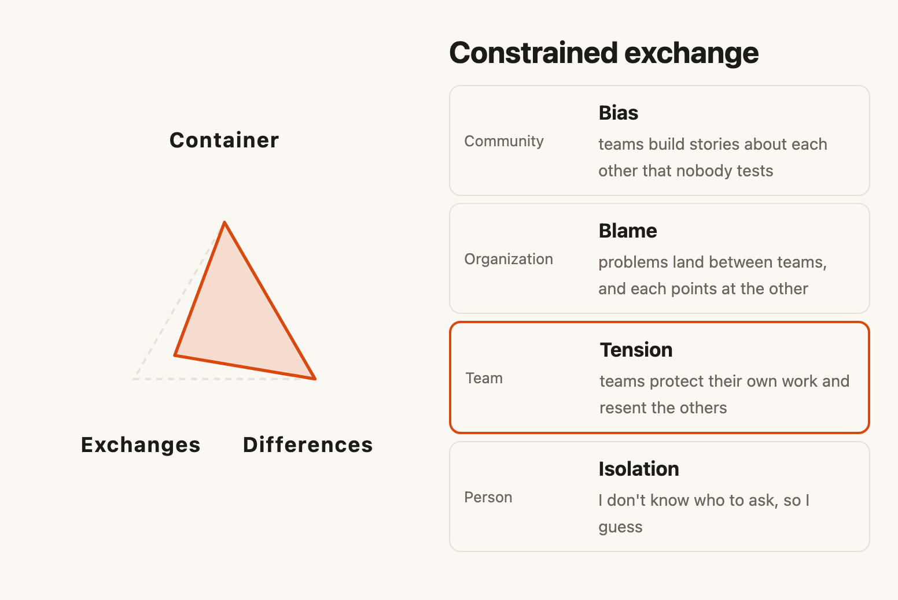
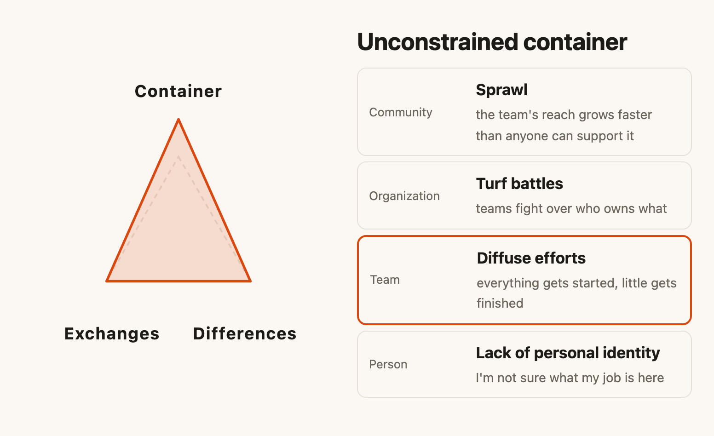
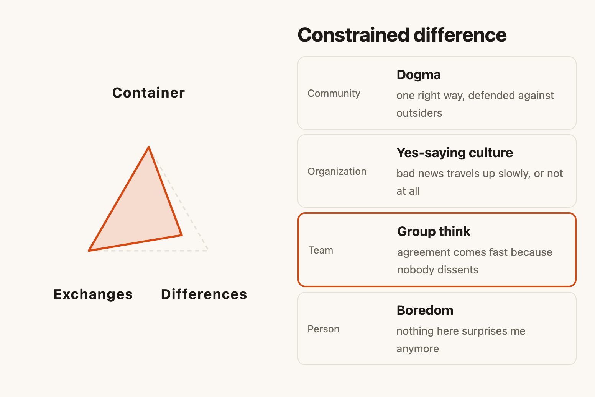
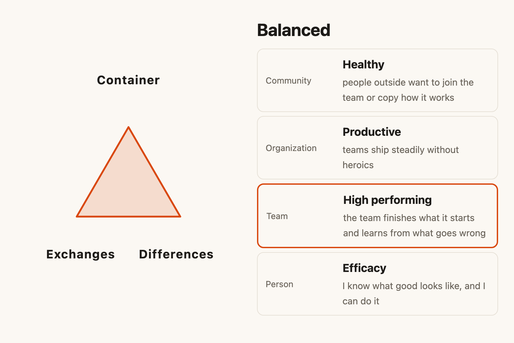

You’ve sat through the retro where everyone agrees the team has a communication problem. Someone proposes a new channel, someone else a weekly sync. A month later the team has both, and the same problem.

The problem lives in the conditions around the people, and those conditions keep producing it until someone changes them. Human Systems Dynamics has a model for those conditions called CDE. I learned it in 2018 and have used it with teams ever since.

## Three conditions

The container holds a group together long enough for a pattern to form. A purpose, a boundary, a shared way of working, a deadline, even a meeting agenda can all be containers.

Differences are the distinctions that matter to the people inside: skills, views, experience, the staff engineer and the new hire.

Exchanges move information and work between people: pairing, tickets, demos, code review, the conversation by the coffee machine.

Each condition can be too tight or too loose. Tight means constrained and rigid; loose means open and unbounded. Give a meeting too much time and it drifts into topics nobody cares about; you tighten it by sharpening the purpose or inviting fewer people. Give it too little and it can’t hold the disagreement it needs; you give it more room.

The model also explains why your fixes surprise you: the three conditions pull on each other. Shrink the container and the differences inside it start to matter more, and the exchanges speed up. You can guess the direction of a change, but you can’t predict or control where it lands.

## Three shapes you may know

Three conditions, each too tight or too loose, plus a team in balance, make seven shapes. Here are three you may recognize.

Exchanges too tight. A platform team and three product teams talk through tickets and nothing else, and each one guards its own roadmap. Integration bugs show up in production, and every postmortem blames the handoff. Ask someone on the team and you’ll hear “I don’t know who to ask, so I guess.” Zoom out and the organization runs on blame: problems land between teams, and each points at the other. In software it looks like Conway’s Law, with the architecture copying the broken communication.

Container too loose. A team takes on whatever the business asks for this quarter: a mobile app, a data pipeline, a partner integration. Nobody can say what the team is for. People start everything and finish little, and the teams around it start fighting over who owns what. We call that a feature factory.

Differences too tight. A group of long-tenured engineers agree on everything. Their estimates match, code review is a formality, and the one person who questioned the architecture stopped speaking up in retros. Bad news travels up slowly, and the team calls it alignment. The model calls it groupthink.

## The tool

A few years ago I started mapping these configurations for software teams in Airtable, with the idea that you could zoom out from a team to the organization around it. It’s now a page you can try: [What shape is your team in?](https://ahmedavais.com/p/team-shape)

You answer three questions: is the container, are the differences, are the exchanges too tight, about right or too loose? A triangle bends into your team’s shape. A ladder shows the same pattern at four levels, from how one person feels at work up to how the community around the team responds. Then you get the agile pattern it looks like, a practice that shifts it, and a next wise action.

The tool lets you move one condition at a time. If more than one feels off, pick the one that feels most off. The conditions are entangled, so when you shift one, the other two move with it.

## Using it with your team

Take it to your next retro. Ask each person to answer the three questions on their own, then compare. The disagreements tell you as much as the answers. If half the team says the container is too loose and the other half says too tight, you’ve found a difference that matters.

Then pick one condition and make one small move. Narrow the container by saying no to one request. Open an exchange across a gap with a shared demo. Bring in a difference by inviting a customer to the sprint review. Watch what changes, and choose your next step from there.

Which shape is your team in right now? I’d like to hear what you found.

This piece first went out in my newsletter, Dynamical Change. [Subscribe](https://ahmedavais.substack.com) to get the next one in your inbox.
